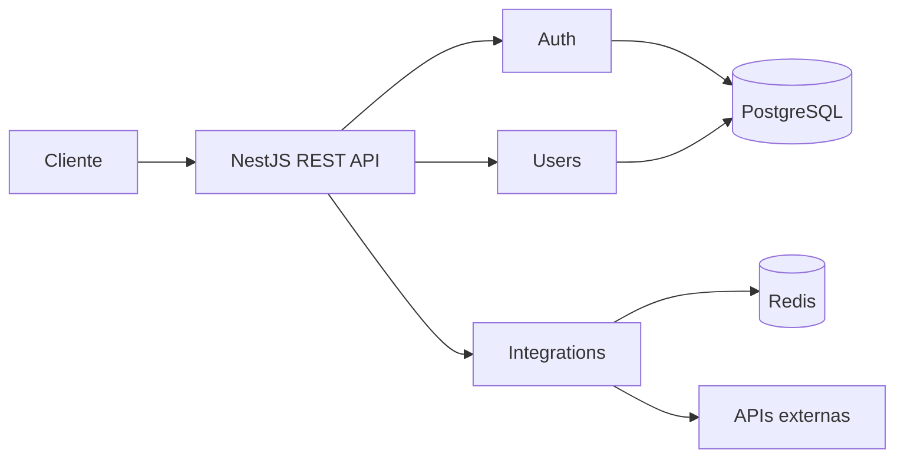

# auth-api

Backend modular criado para servir como:

- base reutilizável para novas APIs;
- laboratório prático de arquitetura e engenharia backend;
- projeto de portfólio para demonstrar decisões técnicas, qualidade e evolução profissional.

O projeto usa NestJS, TypeScript, PostgreSQL, Redis, Docker e OpenAPI. A proposta não é
somente entregar endpoints: é construir uma API com estrutura clara, segurança,
testabilidade e operação reproduzível.

## Status

> Em desenvolvimento — fundação concluída.

### Implementado

- estrutura inicial NestJS com TypeScript;
- organização como monólito modular;
- módulos base de autenticação, usuários, integrações, cache e health;
- endpoint de liveness;
- documentação Swagger inicial;
- contrato OpenAPI inicial;
- Dockerfile multi-stage;
- ambiente Docker Compose com API, PostgreSQL e Redis;
- configuração por variáveis de ambiente;
- lint, testes unitários, testes E2E e build;
- pipeline de CI com GitHub Actions;
- documentação arquitetural e ADR.
- persistência PostgreSQL controlada por migrations;
- schema inicial de usuários e refresh tokens;
- testes automatizados de fronteiras entre módulos.
- cadastro, login e autenticação JWT;
- refresh tokens opacos com rotação e detecção de reutilização;
- logout, perfil próprio, roles e permissões;
- erros HTTP padronizados;

### Planejado

- cache Redis;
- integração com múltiplos providers;
- retry, timeout, fallback e circuit breaker;
- rate limiting e hardening HTTP;
- logs estruturados, métricas e tracing;
- deploy automatizado.

## Objetivos

### Base reutilizável

A estrutura poderá iniciar outros backends sem repetir configuração de:

- organização modular;
- validação;
- documentação OpenAPI;
- testes;
- Docker;
- CI;
- banco e cache;
- práticas básicas de segurança.

Cada novo projeto poderá manter somente os módulos necessários e substituir regras,
providers e contratos específicos.

### Aprendizagem

O repositório registra evolução incremental. Cada fase aplica conceitos em código:

- arquitetura modular;
- autenticação e autorização;
- modelagem e migrations;
- integração com serviços externos;
- cache e resiliência;
- observabilidade;
- segurança;
- testes e entrega contínua.

Decisões relevantes são documentadas em ADRs. Isso permite comparar alternativas,
trade-offs e consequências, não apenas observar código final.

### Portfólio

Para recrutadores e equipes de engenharia, o projeto busca demonstrar:

- capacidade de transformar requisitos em arquitetura implementável;
- domínio de Node.js, TypeScript e NestJS;
- preocupação com segurança e qualidade desde a fundação;
- uso profissional de PostgreSQL, Redis, Docker e CI;
- desenvolvimento incremental com testes;
- documentação clara de decisões técnicas.

## Arquitetura

Foi escolhido um monólito modular. O projeto ainda não possui escala, equipe ou requisitos
operacionais que justifiquem microserviços.



Cada módulo concentra responsabilidades de um contexto. Dependências de banco, cache e
HTTP serão acessadas por contratos, reduzindo acoplamento e facilitando testes.

Regra de dependência planejada:

```text
controller -> application service -> domain port <- infrastructure adapter
```

Detalhes:

- [visão arquitetural](docs/architecture/README.md);
- [ADR-0001: monólito modular](docs/architecture/adr/0001-modular-monolith.md);
- [ADR-0002: autenticação e autorização](docs/architecture/adr/0002-authentication-and-authorization.md);
- [contrato OpenAPI](docs/api/openapi.yaml).

## Stack

| Tecnologia      | Responsabilidade                        |
| --------------- | --------------------------------------- |
| Node.js 22      | runtime                                 |
| TypeScript      | tipagem e segurança estática            |
| NestJS          | framework HTTP e injeção de dependência |
| PostgreSQL      | fonte de verdade                        |
| Redis           | cache e dados efêmeros                  |
| Swagger/OpenAPI | contrato e documentação da API          |
| Jest/Supertest  | testes unitários e E2E                  |
| Docker Compose  | ambiente local reproduzível             |
| GitHub Actions  | integração contínua                     |

Versões exatas estão fixadas em `package.json` e `package-lock.json`.

## Estrutura

```text
.
├── .github/workflows/       # pipeline de CI
├── docs/
│   ├── api/                 # contratos HTTP
│   └── architecture/        # arquitetura e ADRs
├── src/
│   ├── common/              # concerns transversais
│   ├── config/              # configuração da aplicação
│   └── modules/
│       ├── auth/
│       ├── cache/
│       ├── health/
│       ├── integrations/
│       └── users/
├── test/                    # testes E2E
├── compose.yaml
├── Dockerfile
└── package.json
```

## Execução local

### Requisitos

- Node.js 22 ou superior;
- npm 10 ou superior;
- Docker com Docker Compose.

### 1. Clonar

```bash
git clone https://github.com/jfsjao/auth-api.git
cd auth-api
```

### 2. Configurar ambiente

```bash
cp .env.example .env
```

Troque senhas e segredos de exemplo. Nunca versione `.env`.

Para gerar segredos locais:

```bash
openssl rand -base64 48
```

### 3. Executar com Docker

```bash
docker compose up --build
```

O job `migrate` aplica migrations compiladas antes de liberar a API.

Serviços:

- API: <http://localhost:3000>
- Swagger: <http://localhost:3000/docs>
- PostgreSQL: `localhost:5432`
- Redis: `localhost:6379`

### 4. Executar API fora do Docker

Suba somente PostgreSQL e Redis:

```bash
docker compose up -d postgres redis
```

No `.env`, use `localhost` em `DATABASE_URL` e `REDIS_URL`.

Depois:

```bash
npm install
npm run migration:run
npm run start:dev
```

## Endpoints disponíveis

### Health

```http
GET /api/v1/health
```

Resposta:

```json
{
  "status": "ok",
  "service": "auth_api"
}
```

### Autenticação

```http
POST  /api/v1/auth/register
POST  /api/v1/auth/login
POST  /api/v1/auth/refresh
POST  /api/v1/auth/logout
GET   /api/v1/auth/me
PATCH /api/v1/auth/me
```

### Usuários administrativos

```http
GET   /api/v1/users
GET   /api/v1/users/:id
PATCH /api/v1/users/:id
```

Contratos completos:

- [OpenAPI](docs/api/openapi.yaml);
- [autenticação e autorização](docs/security/authentication.md).

## Qualidade

```bash
# Lint
npm run lint

# Testes unitários
npm test

# Testes E2E
npm run test:e2e

# Testes com PostgreSQL real
npm run test:integration

# Build
npm run build

# Validação completa usada pela CI
npm run test:ci
```

A pipeline valida migrations, integração PostgreSQL, lint, testes unitários, testes E2E e
build.

## Segurança

Princípios adotados ou planejados:

- segredos fora do repositório;
- validação global de entradas;
- access tokens de curta duração;
- refresh tokens rotativos armazenados como hash;
- Argon2id para senhas;
- permissões explícitas;
- rate limiting;
- CORS por allowlist;
- mensagens de erro sem detalhes internos;
- auditoria de dependências.

O arquivo `.env.example` contém somente placeholders. Valores de produção devem ser
mantidos em secret manager.

## Roadmap

### Fase 1 — Fundação

- [x] scaffold NestJS;
- [x] módulos iniciais;
- [x] health check;
- [x] Swagger e OpenAPI;
- [x] Docker Compose;
- [x] testes iniciais;
- [x] CI;
- [x] ADR inicial.

### Fase 2 — Usuários e autenticação

- [x] schema e migration inicial;
- [x] cadastro de usuários;
- [x] login;
- [x] access token;
- [x] refresh token rotativo;
- [x] logout e revogação;
- [x] perfil próprio;
- [x] roles e permissões;
- [x] testes de autenticação e autorização.

### Fase 3 — Integrações e cache

- [ ] contrato comum para providers;
- [ ] dois adapters externos;
- [ ] normalização de respostas;
- [ ] cache Redis;
- [ ] timeout, retry e fallback;
- [ ] circuit breaker.

### Fase 4 — Operação

- [ ] logs estruturados;
- [ ] correlation ID;
- [ ] métricas;
- [ ] tracing;
- [ ] readiness checks;
- [ ] deploy automatizado;
- [ ] hardening de produção.

## Decisões e trade-offs

- **Monólito modular:** menor custo inicial; exige disciplina entre módulos.
- **REST:** contrato simples, cacheável e adequado ao escopo atual.
- **PostgreSQL:** consistência e migrations para usuários e autenticação.
- **Redis:** somente cache e estado recriável; nunca fonte de verdade.
- **Docker Compose:** ambiente local reproduzível; não representa orquestração de produção.
- **Desenvolvimento incremental:** cada fase deve concluir testes e documentação antes da
  próxima.

## Como reutilizar

Para iniciar outra API:

1. faça fork ou use este repositório como template;
2. altere nome, descrição e variáveis de ambiente;
3. remova módulos desnecessários;
4. mantenha `common`, `config`, health, testes, Docker e CI;
5. crie módulos por contexto de negócio;
6. registre decisões importantes em novos ADRs.

Evite copiar regras específicas de autenticação ou integração sem revisar requisitos do
novo sistema.

## Contribuição

Projeto pessoal em evolução. Issues e sugestões técnicas são bem-vindas.

Antes de abrir pull request:

```bash
npm run test:ci
```

## Licença

Licença ainda não definida. Enquanto isso, código permanece com `UNLICENSED` em
`package.json`.
