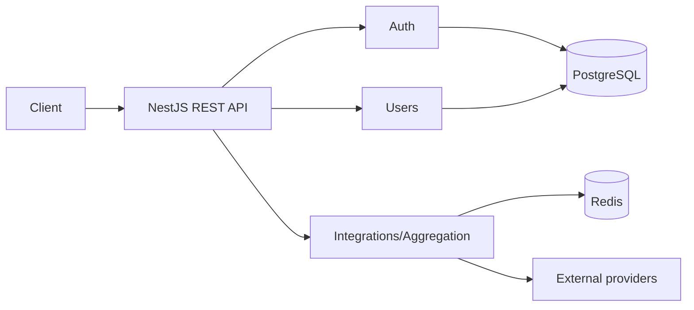

# Arquitetura inicial

## Decisões

- [ADR-0001: Monólito modular com fronteiras por domínio](adr/0001-modular-monolith.md)
- [ADR-0002: Estratégia de autenticação, sessões e autorização](adr/0002-authentication-and-authorization.md)

## Premissas

- produto em estágio inicial, equipe pequena;
- REST em `/api/v1`;
- PostgreSQL como fonte de verdade;
- Redis somente para dados recriáveis;
- NestJS sobre Node.js 22;
- deploy inicial como unidade única.

## Visão

Monólito modular. Cada contexto possui módulo NestJS próprio. Dependências entram por
interfaces; detalhes de banco, cache e HTTP ficam em adapters.



## Regra de dependência

`controller -> application service -> domain port <- infrastructure adapter`.

Módulos não acessam tabela ou implementação interna de outro módulo. Compartilhamento
ocorre por contrato exportado. `common` contém apenas concerns transversais; nunca regras
de negócio.

## Fluxo de agregação

1. Controller valida entrada e identidade.
2. Caso de uso cria chave canônica de cache.
3. Cache hit retorna contrato normalizado.
4. Cache miss consulta adapters em paralelo, com timeout.
5. Caso de uso aceita sucesso parcial conforme política.
6. Resultado normalizado recebe TTL e retorna com metadados de origem.

## Segurança planejada

- access token curto; refresh token opaco, rotativo, armazenado somente como hash;
- Argon2id para senhas;
- RBAC com permissões explícitas;
- validação global com whitelist;
- rate limit, CORS allowlist, headers seguros;
- segredos somente em ambiente/secret manager;
- erro público estável sem stack trace.

## Testes

- unitários: domínio e casos de uso;
- integração: adapters PostgreSQL/Redis;
- E2E: contratos HTTP e autorização;
- contrato: OpenAPI;
- migrations: subir, validar, descer quando rollback for seguro.

## Persistência

TypeORM gerencia conexão e migrations PostgreSQL. `synchronize` permanece desabilitado em
todos os ambientes. Mudanças de schema exigem migration versionada com `up` e `down`.

Comandos:

```bash
npm run migration:show
npm run migration:run
npm run migration:revert
```

Schema inicial:

- `users`: identidade, credencial em hash, role e status;
- `refresh_tokens`: somente hash do token, expiração, revogação e cadeia de rotação;
- índice único case-insensitive para e-mail;
- índices de consulta e foreign keys explícitas.

## Fronteiras automatizadas

`src/architecture.spec.ts` analisa imports TypeScript. Código interno de um módulo não pode
importar implementação interna de outro módulo. Integração entre contextos deve ocorrer por
contrato público ou composição no nível da aplicação.
